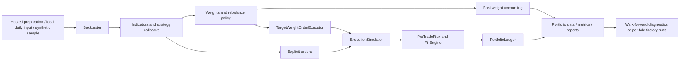

# quantXoa architecture

M0 design, 2026-11-09. Implementation baseline:
`8d1a600a2b857e831560e4d552932b8d843fa90c`.
See [audit](repository-audit.md), [methodology](research-methodology.md),
[milestones](quantxoa-roadmap.md), and [checkpoint](PROGRESS.md).

## Existing system

`strategy.bat` selects `.venv`, then calls `strategy.py`, which launches the
isolated `backtester.cli.strategy_runner`. `Backtester` owns data preparation,
indicators, strategy output validation, execution selection, and reporting.
Existing strategies subclass it. Weight mode implements `_compute_signals`
and `_compute_weights`; order mode uses `_compute_orders` after each completed
simulation row. Callbacks can access whole data frames, so a valid-shaped
output is not proof of causal computation.

The execution layer already separates fills, accounting, and pre-trade risk.
The ledger records cash, positions, notional exposure, static margin, buying
power, and NAV. Reports include JSON/CSV/HTML and PNGs. `StrategyBook` combines
strategy sleeves with lagged allocation changes. Reuse these boundaries.

## Incremental project structure

| Location | Responsibility / status |
|---|---|
| `backtester/` | Existing runtime; preserve namespace and interfaces |
| `strategies/` | Preserve all 51 examples; add experimental variants separately in later milestones |
| `research/` | Planned repository-only experiment entrypoints and comparison orchestration; currently ignored, change deliberately in M1 |
| `configs/` | Planned single source for research specifications, split policy and assumptions |
| `quantxoa/` | Deferred until reusable project code warrants a package; do not create empty layers |
| `data/` | Ignored raw and canonical snapshots; provider licensing applies |
| `reports/` | Ignored runs, logs, manifests, tables, plots, HTML |
| `tests/` | Existing engine contracts plus focused project regression tests |
| `docs/` | Audit, architecture, evaluation protocol, roadmap and persistent checkpoint |

No package renames are needed. Distribution name remains `quantjourney-bt`.
The upstream `docs/ROADMAP.md` is preserved; the project plan uses
`docs/quantxoa-roadmap.md` to avoid a Windows case collision with `roadmap.md`.
`AGENTS.md` is now tracked; generated output exclusions remain in place.

## Planned data and decision boundary

The M2 canonical observation will carry instrument, asset type, UTC bar start,
UTC bar end, availability time, America/New_York session identifier, OHLCV,
price-adjustment basis, source, and snapshot ID. Futures additionally need
dated contract ID, expiry, exchange calendar, and specification version.
Snapshots retain raw input identity and a deterministic normalized checksum.
An expected exchange-session grid distinguishes closures, partial bars, and
missing observations. Missing input never becomes a tradable filled price.

At time t, expose only rows with `available_at <= t`; compute intent, then risk
eligibility, submission, and fills. Audit records link observation IDs,
feature/configuration versions, intent, rejection reason, order, fill, and
portfolio state. Retain last valid marks for valuation only, flagged stale;
do not treat valuation carry-forward as an executable observation.

A project adapter should validate and prepare data before invoking existing
strategy/execution components. Current `local_data` intentionally rejects
intraday and non-equity input. M2 must introduce a tested, explicit intraday
path; changing timestamps or pretending hourly data is daily is unacceptable.
Prefer additive preparation support behind existing interfaces. Use the
standalone `ExecutionSimulator` for focused adapter verification. Any core
extension must preserve daily behavior and receive regression coverage.

## Execution and risk boundaries

Preserve W09's fast-weight example as a reference. New comparable candidates
must share an order-based fill model with explicit decision-to-fill timing,
fees, spread/slippage, borrow assumptions, quantity limits, and exposure caps.
Fast-weight returns alone cannot establish next-open executable performance.

Reuse `PreTradeRisk` for configured leverage/margin checks and the existing
weight risk models for separately tested volatility controls. Add daily-loss,
staleness, idempotency, safety latch, and reconciliation controls only with
their milestone's tests. Existing defaults do not implement the requested
research safeguards. See the [audit](repository-audit.md) for futures gaps.

Research and optional future paper execution share intent/order schemas only
after those contracts are tested. No broker adapter or live path is added in
M0. M9 is a readiness assessment; M10 remains separately authorized.

## Reproducibility and acceptance

Each eventual experiment records code SHA and dirty state, lockfile hash,
data manifest and checksum, exact effective configuration, calendar version,
execution assumptions, seeds, split boundaries, parameter trials, and artifacts.
A run ID hashes canonical configuration plus data/code/environment identities.
The report distinguishes synthetic, development, validation, and sealed holdout
evidence. Unavailable metrics are null with reasons, never plausible zeroes.

M0 delivers a working Windows baseline and documented boundaries. It does not
deliver an hourly adapter, strategy comparison engine, or validated candidate.
